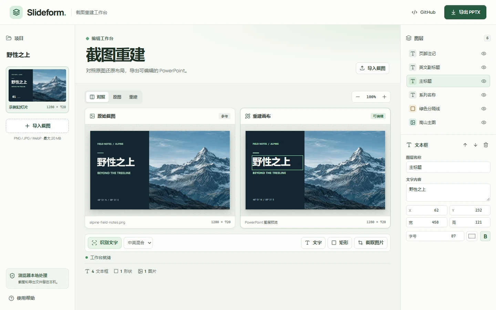

# Slideform · 截图重建工作台

Slideform 把单页幻灯片截图转化为可编辑的 PowerPoint。浏览器工作台提供 OCR 和图层编辑，Codex 技能提供原图分析、高保真还原、已有演示文稿换图和验收流程。



## 启动工作台

需要 Node.js 22.12 或更高版本。

```sh
npm ci
npm run dev
```

打开终端给出的本地地址。工作台会先载入「野性之上」示例。

1. 导入一张 PNG、JPG 或 WebP 截图，最大 20 MB。
2. 选择识别语言，点击「识别文字」。对照原图校对文字、位置、字号、颜色和图层顺序。
3. 添加文本框或矩形。在原图拖选区域，生成独立图片层。选中图片层即可更换素材并保留图层位置与尺寸。
4. 导出 `.pptx`。PowerPoint 的选择窗格中会显示图层名称，文本框和矩形可直接编辑，图片可独立替换。

OCR 引擎和语言模型随网站构建产物提供。首次识别会从工作台所在站点加载这些静态文件，截图、素材和导出的演示文稿均在浏览器内处理。当前项目存放在浏览器内存，刷新后会重新载入示例。

网站支持单页截图。OCR 的位置与字体为估算值，复杂图表、纹理、文字遮挡和已有 PPTX 的原位换图，可使用下方 Codex 技能完成。

## 安装 Codex 技能

在 Codex 对话中发送下列指令，从本仓库安装技能及其参考资料。

```text
$skill-installer https://github.com/Yunique-hub/Ppt-Rebuild-/tree/main/skills/ppt-screenshot-rebuild
```

安装后输入 `$ppt-screenshot-rebuild`，并提供截图、原始素材或待编辑的 PPTX。入口在 [SKILL.md](skills/ppt-screenshot-rebuild/SKILL.md)。

## 开发与验证

```sh
npm test
npm run build
npx playwright install chromium
npm run test:e2e
```

构建产物位于 `dist/`，可以部署到静态站点。模块划分、测试和数据边界见[架构说明](docs/architecture.md)。
